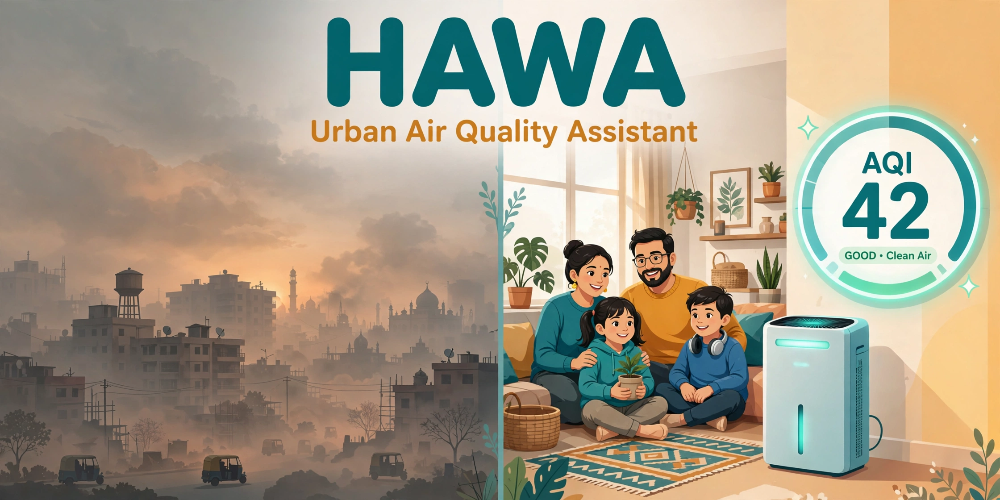

# Hawa — Urban Air Quality Assistant

**Hack2skill PromptWars Virtual — Challenge 06: Urban Air Quality Assistant**
**Deadline: Sun 29 Nov 2026, 23:59 IST** · 3 submission attempts · Top 400 earns Swag Credits

Hawa helps families in smog-prone Indian cities decide what to do today — when to ventilate, how to commute, how to protect children and older adults, and what actually helps indoors — using live AQI on the India CPCB scale, transparent reasoning, and a GenAI-built decision engine that explains rather than invents.

## Live demo

Public link (Vercel, live): https://hawa-air-quality-assistant.vercel.app/

## What it does

- **Live AQI, on the CPCB scale** — tap any city to fetch its live PM2.5/PM10 from the Open-Meteo Air Quality API (no API key) and convert it to the India CPCB AQI. The reading time, PM values and source are shown on screen. The US AQI number from the API is deliberately never used. If the fetch fails (offline or API unavailable), the app falls back to clearly labelled typical winter-morning examples — never fake "live" data.
- **Best / worst windows, next 24 h** — from the hourly forecast, Hawa shows the cleanest hour for walks, play and ventilation and the worst hour to stay in for.
- **Interactive AQI decision engine** — set the AQI (slider/input) or pick a city; verdicts update instantly for school run, walks, kids' play, exercise, ventilation and masks, on the India CPCB scale.
- **Hour-by-hour low-emission routine** — best and worst windows for outdoor time, exercise and ventilation.
- **Family profiles** — Child, Adult, Elderly, Asthma / sensitive. Each gets its own risk level, outdoor-time limit, mask and activity guidance.
- **Today's low-emission plan** — commute mode (metro / bus / car-pool / walk in a clean window), cooking, cleaning and errand timing, each with an explained impact.
- **Indoor air hacks** — a checklist that actually works: cross-ventilate only in clean windows, wet-mop instead of dry sweeping, DIY box-fan filter, kitchen exhaust while cooking, sealing gaps. Myths flagged (e.g. houseplants do not clean room air at any meaningful rate).
- **Family Plan builder** — who's home, purifier, home type, travel mode; generates a personalised plan you can copy or download as .txt.
- **Mask & purifier guides, myths, red flags** — when a mask helps, what a purifier can and can't do, and the warning signs that mean see a doctor.
- **Impact, explained** — every recommendation shows its basis on screen, not a black-box verdict.

## Data sources

- **Live:** [Open-Meteo Air Quality API](https://open-meteo.com/en/docs/air-quality-api) (CAMS model) — current + hourly PM2.5/PM10 via [Open-Meteo Geocoding API](https://open-meteo.com/en/docs/geocoding-api). Verified live 25 Nov 2026 (Hyderabad: PM2.5 6.8 µg/m³, US AQI 55) and again 26 Nov 2026 (Hyderabad: PM2.5 13.4 µg/m³, US AQI 51, 24 h forecast US AQI 50–59). No API key needed.
- **Scale:** India CPCB National AQI bands. Conversion uses the official CPCB PM2.5/PM10 breakpoint tables with linear interpolation inside each bracket; the AQI is the **max** of the pollutant sub-indices (see `assets/aqi-core.js`).
- **Honesty note:** city values shown before a live fetch succeeds are labelled typical winter-morning **examples**, with links to CPCB live data — the app does not claim them as live readings. Live readings come from the CAMS model, not a sensor in the user's street, so hyperlocal values will differ.

## Health guidance basis

AQI bands follow the India CPCB scale (0–50 Good, 51–100 Satisfactory, 101–200 Moderate, 201–300 Poor, 301–400 Very Poor, 401–500 Severe). Guidance is general information, not medical advice — people with asthma or heart/lung conditions should follow their doctor's plan.

## Prompt strategy

See `TECHNICAL-BLOG.md` — it documents the exact prompts used to build Hawa with GenAI, the live-AQI prompt strategy, the CPCB conversion, what was kept, what was corrected, and why.

## Run it

No build step, no API key. Serve the folder over HTTP (module-free, plain `<script>` tags) and open `index.html`:

```bash
cd hawa-air-quality-assistant
python3 -m http.server 8000
# open http://localhost:8000
```

Or open the public Vercel link above.

## Run the tests

The AQI maths in `assets/aqi-core.js` is pure logic (no DOM, no fetch) and is covered by 41 assertions in `assets/tests.js` — band classification at every CPCB boundary, PM2.5/PM10 sub-index conversion including boundary values, the max-rule, best/worst windows, and verdict/decision logic.

```bash
node assets/tests.js   # 41/41 tests passed
```

Or open the app in a browser and click **Run tests** — pass/fail counts appear on the page.

## Project layout

```
index.html            App shell (references assets/, no embedded base64)
cover.png             README cover image
assets/
  styles.css          Design tokens, layout, components
  aqi-core.js         Pure logic: CPCB bands, PM→CPCB sub-index conversion,
                      max-rule, verdicts & decisions (no DOM, no fetch)
  app.js              DOM + Open-Meteo fetch, reading time + source display,
                      fallback examples, best/worst 24 h windows, all features
  tests.js            41-assertion suite for aqi-core.js (Node + in-browser)
  hero.webp           In-app hero illustration
```

## Submission

- Hack2skill dashboard: https://hack2skill.com/event/pwvirtual1/dashboard/submissions
- Leaderboard: https://hack2skill.com/event/pwvirtual1/dashboard/leaderboard
- Attempt 1 submitted 25 Nov 2026 ~19:09 IST (rank #580 / 55,737 at submission). This v2 package is prepared for Attempt 2 — submit only on Madhav's go-ahead. Attempts are limited to 3.
